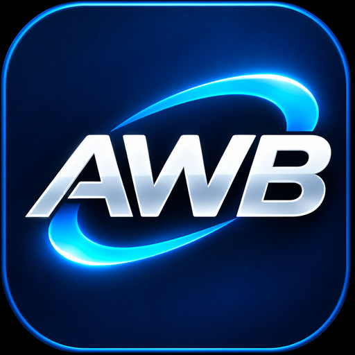

# AI Workflow Bridge

[Nederlands](README.md)

**AI Workflow Bridge makes working with Claude Code and Codex faster, simpler, and easier to follow.**

Through MCP, they exchange tasks and results without constant copying and pasting. A built-in archive keeps tasks, results, and task history. Savepoints let you record progress and pick up where you left off.

ChatGPT can optionally coordinate tasks and review results over a secure connection. The complete ChatGPT cloud workflow has yet to be verified with this release.

*Less manual work. Clearer progress. Better collaboration.*

## What has been tested?

- **Local coding workflow.** An earlier laptop test confirmed that Claude Code could send a task to Codex through AWB, Codex could fix the sample calculator, and the pinned test and result checks passed.
- **Windows installer.** EXE installation and removal were tested in isolation, with user data preserved. The removal test used a simulated confirmation. The r024 checks covered wizard startup in Dutch and English and the new welcome artwork.
- **ChatGPT over HTTPS.** Optional and configured separately. End-to-end testing with the final release is still pending.

## Install on Windows

Use Windows 10 or 11 on x64, a standard user account, and the .NET 10 SDK and runtime. Install the clients you want to use and sign in to Codex for coding tasks. [Official .NET 10 downloads](https://dotnet.microsoft.com/download/dotnet/10.0)

1. Download `AI-Workflow-Bridge-Setup-1.0.0-r024.exe` from the official GitHub release under **Releases**.
2. Optionally download `AI-Workflow-Bridge-Setup-1.0.0-r024.exe.sha256`. Compare its hash with the output of `Get-FileHash -Algorithm SHA256 .\AI-Workflow-Bridge-Setup-1.0.0-r024.exe` in the download folder.
3. Close Claude Code and Codex. Double-click the EXE.
4. Choose **English** or **Nederlands** and accept the license.
5. Choose the installation folder. Use a new local folder for a first installation.
6. Select **Configure Claude Code**, **Configure Codex**, or both. Both boxes are unchecked by default. For Claude Code, also choose your existing project folder.
7. Review the proposed configuration path and AWB adapter for each client. Confirm only the changes you want. AWB makes a verified backup of any existing configuration. Keep the rollback receipt it displays.
8. Restart the connected clients. Look for `awb` using `/mcp` in Claude Code or `codex mcp get awb` in Codex.

### First task

Open the AWB installation folder in PowerShell. Run `.\Authorize-AWBProject.ps1 -Apply` and enter `AUTHORIZE` to authorize the sample Calculator project. Then ask Claude Code: **Fix Calculator.Add in the authorized Calculator project, run the pinned test, and retrieve the result.**

### Uninstall

Close both clients and wait for the AWB hub to stop. In Windows, open **Settings → Apps → Installed apps**, choose **AI Workflow Bridge**, and confirm removal. AWB removes the registered software. Projects, authorizations, task history, savepoints, and client configurations are retained by default.

### Alternative for experienced users

Download `AI-Workflow-Bridge-1.0.0-r021.zip` and its SHA-256 file. Verify the hash, extract the archive, and open Windows PowerShell 5.1 or PowerShell 7 in the extracted folder.

1. Run `.\Verify-AWB.ps1`.
2. Run `.\Install-AWB.ps1 -Destination '<new local folder>'`. Use a new folder whose parent already exists.
3. Close the clients, open the installation folder, and run `.\Setup-AWB.ps1`. Review the proposed changes and confirm each client with `CONFIGURE`.

The ZIP guides also cover rollback and removal through PowerShell.

## Optional: ChatGPT over HTTPS

**AWB does not install or configure an HTTPS tunnel.** Claude Code and Codex communicate locally with the AWB adapter over MCP stdio. When you use ChatGPT in Chrome, ChatGPT runs in the cloud and cannot use that local connection directly. A suitable HTTPS tunnel and custom MCP connection can give ChatGPT access to selected AWB tools to coordinate tasks and retrieve results.

You choose and configure the tunnel service separately. Use appropriate authentication, restrict remote access to trusted users, and expose only authorized MCP functions, projects, and files. Remote access can expose data or enable unintended changes. Custom MCP availability depends on your ChatGPT workspace permissions and settings. [Custom MCP servers in ChatGPT](https://developers.openai.com/api/docs/guides/custom-mcp-server) · [OpenAI Secure MCP Tunnel](https://developers.openai.com/api/docs/guides/secure-mcp-tunnels)

AWB is free and open source under MIT. A separate tunnel service, subscription, or API usage may incur charges. A ChatGPT subscription is not itself OpenAI API credit. Any API credit benefit available to eligible subscribers must be activated separately. [Official API credit information](https://developers.openai.com/api/docs/guides/chatgpt-api-credits)

## Technical details

Both local clients use the same bounded MCP adapter. Project authorization determines which files AWB may change and which pinned test it may run. The example grant allows changes to `Calculator.cs` and pins one offline test by SHA-256. The document limit is 2 MiB. Claude Desktop and Claude Code have separate configurations. This guide covers Claude Code.
