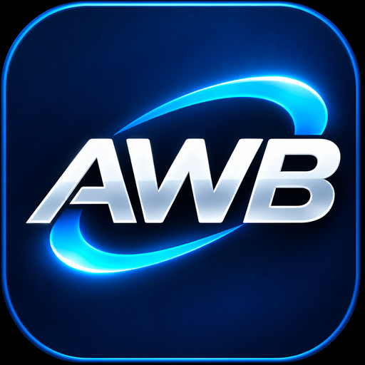

# AI Workflow Bridge

[English](README.en.md)

**AI Workflow Bridge maakt de samenwerking tussen Claude Code en Codex sneller, eenvoudiger en overzichtelijker.**

Via MCP wisselen ze opdrachten en resultaten uit, zonder voortdurend te hoeven knippen en plakken. Een ingebouwd archief bewaart opdrachten, resultaten en taakgeschiedenis. Met savepoints leg je de voortgang vast zodat je later verder kunt werken waar je gebleven was.

ChatGPT kan optioneel via een beveiligde verbinding opdrachten coördineren en resultaten controleren. De volledige ChatGPT-cloudketen is met deze release nog niet bewezen.

*Minder handmatig werk. Meer overzicht. Betere samenwerking.*

## Wat is getest?

- **Lokale programmeerketen.** Een eerdere laptopproef bevestigde dat Claude Code via AWB een opdracht aan Codex kon geven, dat Codex de voorbeeldcalculator herstelde en dat de vastgelegde test en resultaatcontrole slaagden.
- **Windows-installer.** De EXE-installatie en de verwijderfunctie zijn in een geïsoleerde omgeving getest met behoud van gebruikersgegevens. De verwijderproef gebruikte een gesimuleerde bevestiging. Voor r024 zijn de Nederlandse en Engelse wizardstart en het nieuwe welkomstbeeld gecontroleerd.
- **ChatGPT via HTTPS.** Optioneel en afzonderlijk te configureren. Een volledige proef met de definitieve release staat nog open.

## Installeren op Windows

Gebruik Windows 10 of 11 op x64, een gewone gebruikersaccount en de .NET 10 SDK en runtime. Installeer de clients die je wilt gebruiken en meld je aan bij Codex voor programmeeropdrachten. [Officiële .NET 10-downloads](https://dotnet.microsoft.com/download/dotnet/10.0)

1. Download `AI-Workflow-Bridge-Setup-1.0.0-r024.exe` via het tabblad **Releases** bij de officiële GitHub-release.
2. Download desgewenst ook `AI-Workflow-Bridge-Setup-1.0.0-r024.exe.sha256`. Vergelijk de hash in dat bestand met de uitvoer van `Get-FileHash -Algorithm SHA256 .\AI-Workflow-Bridge-Setup-1.0.0-r024.exe` in de downloadmap.
3. Sluit Claude Code en Codex. Dubbelklik op de EXE.
4. Kies **Nederlands** of **English** en accepteer de licentie.
5. Kies de installatiemap. Gebruik voor een eerste installatie een nieuwe lokale map.
6. Vink **Claude Code configureren**, **Codex configureren** of beide aan. Beide vakjes staan standaard uit. Kies voor Claude Code ook je bestaande werkmap.
7. Controleer per client het voorgestelde configuratiepad en de AWB-adapter. Bevestig alleen de gewenste wijzigingen. Bij een bestaande configuratie maakt AWB een gecontroleerde back-up. Bewaar het getoonde herstelbewijs.
8. Start de gekoppelde programma’s opnieuw. Controleer `awb` via `/mcp` in Claude Code of `codex mcp get awb` in Codex.

### Eerste opdracht

Open de AWB-installatiemap in PowerShell. Voer `.\Authorize-AWBProject.ps1 -Apply` uit en bevestig de autorisatie van het fictieve Calculator-project met `AUTHORIZE`. Vraag daarna in Claude Code: **Herstel Calculator.Add in het geautoriseerde Calculator-project, voer de vaste test uit en haal het resultaat op.**

### Verwijderen

Sluit beide clients en wacht tot de AWB-hub is gestopt. Ga in Windows naar **Instellingen → Apps → Geïnstalleerde apps**, kies **AI Workflow Bridge** en bevestig de verwijdering. AWB verwijdert de geregistreerde software. Projecten, autorisaties, taakgeschiedenis, savepoints en clientconfiguraties blijven standaard behouden.

### Alternatief voor ervaren gebruikers

Download `AI-Workflow-Bridge-1.0.0-r021.zip` en het bijbehorende SHA-256-bestand. Controleer de hash, pak het archief uit en open Windows PowerShell 5.1 of PowerShell 7 in de uitgepakte map.

1. Voer `.\Verify-AWB.ps1` uit.
2. Voer `.\Install-AWB.ps1 -Destination '<nieuwe lokale map>'` uit. Gebruik een nieuwe map waarvan de bovenliggende map bestaat.
3. Sluit de clients, open de installatiemap en voer `.\Setup-AWB.ps1` uit. Controleer de voorgestelde wijzigingen en bevestig per client met `CONFIGURE`.

De handleidingen in de ZIP beschrijven ook herstel en verwijdering via PowerShell.

## Optioneel: ChatGPT via HTTPS

**AWB installeert of configureert geen HTTPS-tunnel.** Claude Code en Codex communiceren lokaal met de AWB-adapter via MCP over stdio. Als je ChatGPT in Chrome gebruikt, draait ChatGPT in de cloud en kan het die lokale verbinding niet rechtstreeks gebruiken. Een geschikte HTTPS-tunnel en aangepaste MCP-koppeling kunnen ChatGPT toegang geven tot geselecteerde AWB-tools om opdrachten te coördineren en resultaten op te halen.

Je kiest en configureert de tunneldienst zelf. Gebruik passende authenticatie, beperk externe toegang tot vertrouwde gebruikers en geef uitsluitend toegang tot geautoriseerde MCP-functies, projecten en bestanden. Externe toegang kan gegevens blootstellen of onbedoelde wijzigingen mogelijk maken. De beschikbaarheid van aangepaste MCP-koppelingen hangt af van de rechten en instellingen van je ChatGPT-werkruimte. [Aangepaste MCP-server in ChatGPT](https://developers.openai.com/api/docs/guides/custom-mcp-server) · [OpenAI Secure MCP Tunnel](https://developers.openai.com/api/docs/guides/secure-mcp-tunnels)

AWB is gratis en open source onder MIT. Een externe tunneldienst, abonnement of afzonderlijk API-gebruik kan kosten met zich meebrengen. Een ChatGPT-abonnement is op zichzelf geen OpenAI API-tegoed. Eventueel API-tegoed voor in aanmerking komende abonnementen moet apart worden geactiveerd. [Officiële informatie over API-tegoed](https://developers.openai.com/api/docs/guides/chatgpt-api-credits)

## Technische achtergrond

Beide lokale clients gebruiken dezelfde begrensde MCP-adapter. Een projectautorisatie bepaalt welke bestanden AWB mag aanpassen en welke vaste test mag draaien. De voorbeeldautorisatie beperkt wijzigingen tot `Calculator.cs` en legt één offline test vast met SHA-256. De documentlimiet is 2 MiB. Claude Desktop en Claude Code hebben afzonderlijke configuraties. Deze handleiding gaat over Claude Code.
